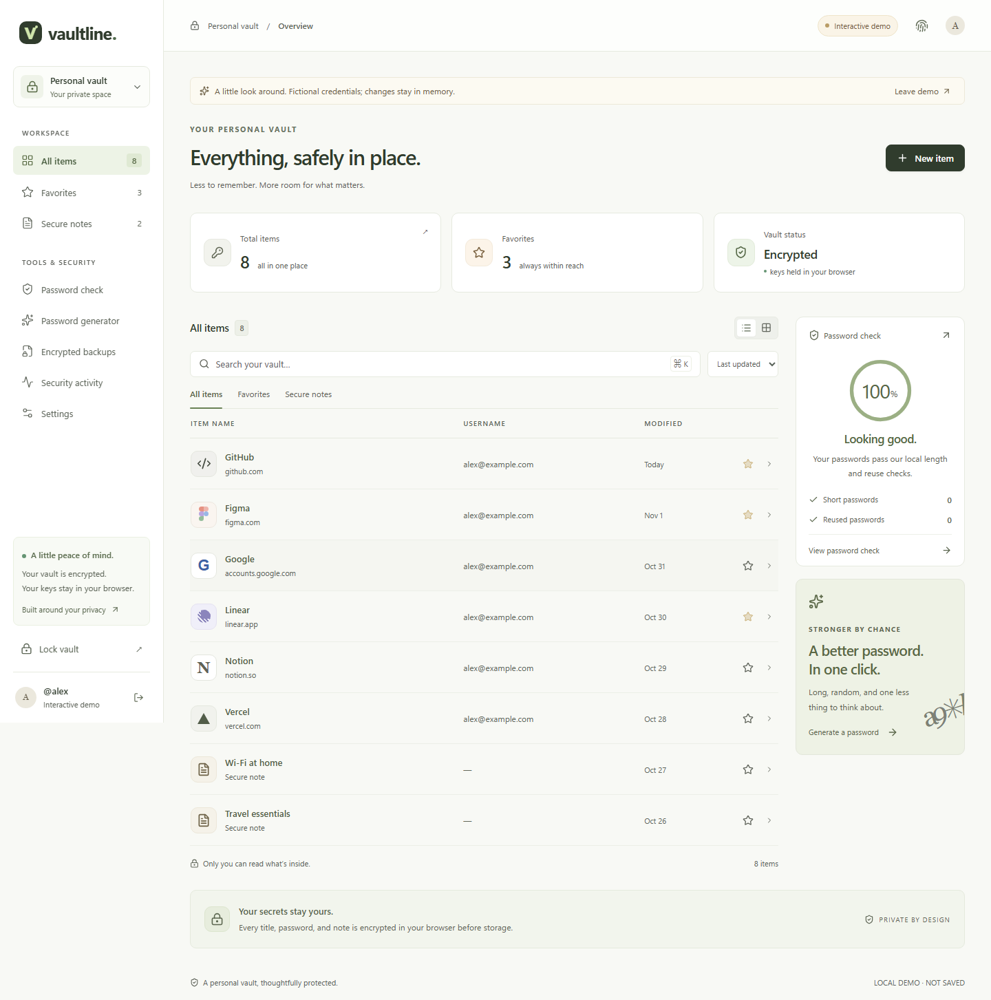

# Vaultline

A personal password manager with browser-side encryption, passkey authentication, reliable saves, and verified backup restoration.

Built as a full-stack engineering portfolio project following [PLAN.md](PLAN.md). The focus is on making security and reliability decisions observable and explainable. **This is a portfolio prototype. Use fictional credentials until it has undergone independent security review.**



## Run on this Windows workspace

Requires Node.js 24 or newer. PostgreSQL runs locally through the included development launcher; Docker is optional.

```powershell
npm.cmd install
npm.cmd run dev
```

Open **http://localhost:5173**. Choose **Explore the interactive demo** to try fictional entries immediately, or create a real application account using a passkey. Your browser/device must support user-verified passkeys to create an account. The demo requires no account and stores changes only in memory.

On macOS/Linux, use `npm` instead of `npm.cmd`. On Windows, `npm.cmd` works when PowerShell's script policy blocks `npm.ps1`.

The launcher applies checked-in migrations and starts the API on `127.0.0.1:3001` and Vite on `127.0.0.1:5173`. With no `DATABASE_URL`, it uses the development PostgreSQL instance on `127.0.0.1:54329`. Data is kept in ignored `.local/postgres`. Both `vaultline` and the isolated `vaultline_test` database are created. Existing PostgreSQL services are reused; the launcher only attempts to stop a database it started itself.

The first dependency installation downloads PostgreSQL binaries for your platform. Linux processes running as root should use an existing PostgreSQL service or Docker; this project does not create system users.

Optional configuration lives in `.env`; see [.env.example](.env.example). Development credentials in that file and Compose are public local fixtures, not deployment secrets. Never expose the development database to the internet. Keep the origin exactly `http://localhost:5173`; opening `127.0.0.1` in the browser changes the origin used for passkey/CSRF verification.

## What works

- Account creation and sign-in with discoverable, user-verified passkeys.
- Separate local vault creation/unlocking using a master passphrase.
- AES-256-GCM encryption of titles, websites, usernames, passwords, notes, favorites, and item categories.
- Argon2id key derivation in a dedicated worker: 64 MiB, three iterations, four lanes, 256-bit output, random 128-bit salt.
- Password and secure-note CRUD; local search; favorites; list/grid views and sorting.
- Unbiased cryptographically random password generation and local length/reuse checks.
- Manual, cross-tab, and configurable idle locking. Reload starts locked.
- Explicit stale-revision conflicts, transactional imports, and idempotent save/import retries.
- Encrypted exports with an authenticated complete manifest, and restoration under a different vault's key.
- Session listing/revocation, additional passkey enrollment, recent passkey verification, and master-passphrase changes.
- Minimal server-verifiable activity; no claimed audit events for local reveal/copy/export actions.
- Responsive interface, native dialog focus management, keyboard search shortcut, and checked contrast.

Limits: 1,000 entries, 10 MiB of serialized encrypted entry storage, and one million accepted write units per vault. Imports charge a unit per entry. These bound the prototype's stored workload and accepted encryption operations; they cannot constrain arbitrary encryption performed by a modified client. Encrypted exports are limited to 20 MiB on import.

## Architecture

```text
React interface → crypto worker → encrypted transport → Fastify → PostgreSQL
      ↑             keys stay here                         ciphertext + metadata
      └──── passkey sign-in + opaque HttpOnly session ────────────────┘
```

The master passphrase never goes to the API. Argon2id derives a wrapping key; that key encrypts a random data key. The data key encrypts entry fields. Account authentication grants access to encrypted records and does not unlock them.

See [architecture](docs/architecture.md), [threat model](docs/threat-model.md), and [design decisions](docs/decisions/001-design.md).

## Verify

Start the local database with `npm.cmd run db:local` in a separate terminal, or keep `npm.cmd run dev` running. Then:

```powershell
npm.cmd run check
npx.cmd playwright install chromium
npm.cmd run test:e2e
npm.cmd audit
```

`check` runs TypeScript, ESLint, 23 unit/integration tests, and the production build. Browser tests build and serve the actual packaged application at `http://localhost:5174`, using `vaultline_test`; they do not rely on a Vite proxy. They exercise eight complete stories, including passkeys via Chromium's virtual authenticator, lost-response retries, two-tab conflicts, backup restoration, key changes, session revocation, and idle locking. These tests use synthetic secrets and reject test database names that do not end in `_test`.

For a recovery drill:

```powershell
npm.cmd run test:recovery
```

This requires PostgreSQL 18 client tools (`pg_dump` and `pg_restore`). They are already available in this workspace's ignored `.local/tools/postgresql/bin`. On a fresh checkout, install the official [EDB PostgreSQL binaries](https://www.enterprisedb.com/download-postgresql-binaries) and set `PG_BIN` to the directory containing both tools. The drill only accepts the isolated local test service. It creates precisely named disposable databases, dumps synthetic encrypted data, destroys the synthetic source, restores the dump, verifies decrypted fields, and cleans up its disposable databases. It never targets the application's `vaultline` database.

Actual results and limitations are in [security verification](docs/security-verification.md), [recovery evidence](docs/evidence/recovery-drill.json), and [benchmark evidence](docs/evidence/benchmark.json).

## Docker and production

For the optional local Docker stack:

```text
docker compose up --build
```

Open `http://localhost:3001`. Stop the native development API/database first if they occupy ports 3001/54329. Compose uses explicitly public development credentials and development cookie settings; it is not the production configuration.

The Dockerfile has separate build, migration-capable, and restricted runtime stages. For production, provision PostgreSQL privately, run migrations as its owner, create a restricted application role using [runtime-grants.sql](prisma/runtime-grants.sql), and configure HTTPS/origin/RP ID using [.env.production.example](.env.production.example). The production server refuses an elevated runtime role or mutable event-table access. Schedule event retention through a separate maintenance role.

See the [runbook](docs/runbook.md) for deployment, maintenance, and recovery steps. Docker and a public HTTPS deployment were not available for execution in this workspace; container files and CI are supplied, with that verification limit recorded.

## Project map

```text
apps/web/src/             React UI, in-memory vault state, crypto worker
apps/api/src/             Authentication, sessions, encrypted storage, security hooks
packages/vault-crypto/    Versioned encryption, KDF, generator, authenticated backups
packages/contracts/      Strict transport and decrypted-field schemas
prisma/                  Database schema, migrations, runtime grants
scripts/                 Local startup, recovery drill, maintenance
tests/e2e/               Browser stories with a virtual authenticator
docs/                    Threat model, evidence, decisions, operational runbook
```

## Security boundaries

A database-only theft exposes ciphertext and operational metadata, and still permits offline guessing of weak master passphrases. A compromised browser or server-delivered malicious JavaScript can expose an unlocked vault. Browser memory cannot be reliably zeroized. Revoking a session prevents future API access; it cannot erase secrets already copied to another device.

Forgotten master passphrases cannot be recovered. Passkeys authenticate the account; they do not recover the encryption key. All passkeys lost means no server-account recovery in this version; an existing encrypted export plus its passphrase can be restored into a new account. Changing the master passphrase does not revoke historical backups or old ciphertext copies.

The project does not claim independent audit, regulatory certification, or proven protection against malicious server rollback. Clipboard contents remain shared with other applications. No analytics, third-party favicons, external fonts, password-breach calls, or AI services receive vault contents.

For an interview walkthrough, follow [docs/demo.md](docs/demo.md).

A short interface recording is available at [docs/demo.webm](docs/demo.webm). It uses only the fictional, in-memory demo. While the development server is running, `npm run record:demo` recreates it and `npm run benchmark` recreates the recorded synthetic performance measurements.
